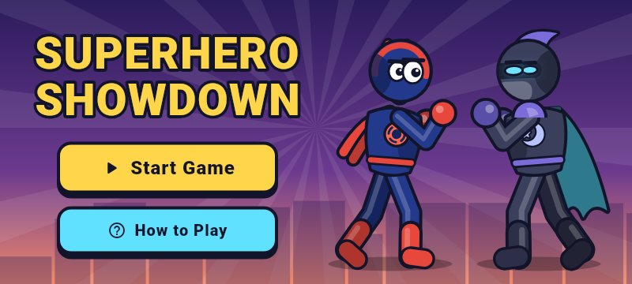
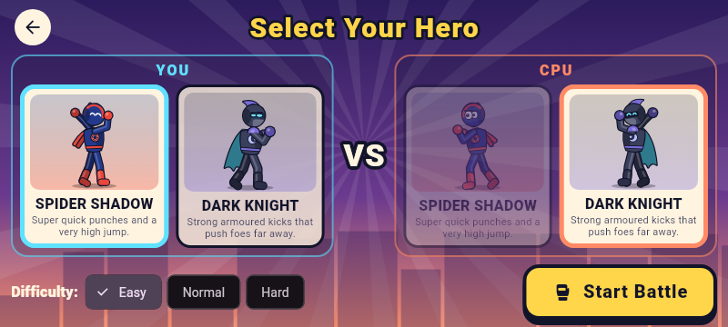
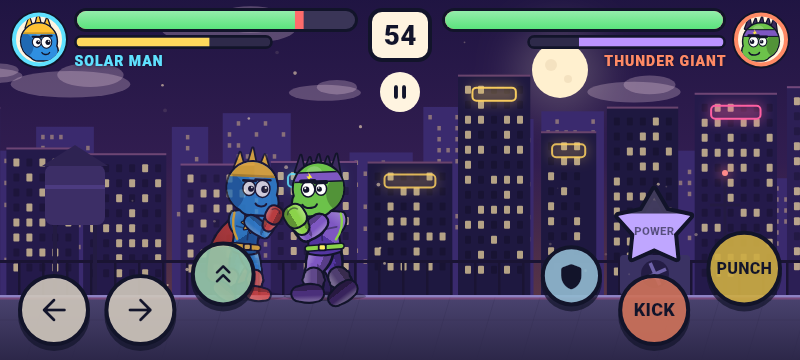

# Superhero Showdown

A family-friendly 2D one-on-one superhero fighting game for Android, built
with Flutter and the Flame engine. Player versus computer, fully offline, no
ads, no purchases, no accounts.

**Status: Milestone 1 plus superpowers and all five heroes.**

| Hero | Superpower |
| --- | --- |
| Spider Shadow | **Web Shot**: a sticky web that holds the foe in place |
| Dark Knight | **Night Strike**: zooms across the arena wrapped in moonlight |
| Solar Man | **Sun Beam**: a warm golden beam of sunshine |
| Thunder Giant | **Thunder Stomp**: a thunder wave rolls along the ground (jump over it!) |
| Iron Falcon | **Plasma Blast**: a bright plasma ball from the energy core |

Superpowers are kept simple for young children: the power meter under each
health bar fills up by itself (faster when you land or take hits). When it
glows gold, tap the big **POWER** star. Heroes can't be interrupted while
powering up, so the move always comes out.

| Main menu | Hero select | Battle |
| --- | --- | --- |
|  |  |  |

## What Milestone 1 includes

- Landscape-only Android app, immersive full screen.
- Main menu with a How to Play guide.
- Two-step character selection with big animated hero cards: tap your
  hero, tap who to fight (or Surprise Me), pick a difficulty (Easy by default).
- Animated "HERO VS HERO" introduction.
- Five original heroes in a cute chibi style, each with different stats
  (speed, jump height, damage, reach) and their own superpower.
- One arena, **Neon City Rooftop**, with parallax skyline layers, slowly
  glowing signs, drifting clouds, a spinning roof fan and floating light motes.
- Walking, jumping with air control, punch, kick and block.
- A real combat engine: hitboxes and hurtboxes, attack startup, active and
  recovery frames, one hit per swing, knockback, hit stun, invulnerability
  after a hit, chip damage through blocks and a guarded state machine.
- Computer opponent with approach, spacing, attacks, jumps, blocking and a
  more defensive style at low health. Easy, Normal and Hard settings.
- Animated health bars (a red trail shows how much a hit took), portraits,
  names and a 60 second round timer.
- Cartoon knockout with dizzy eyes, orbiting stars and smoke puffs.
- Victory, defeat and draw screens with Try Again, Change Heroes and Main Menu.
- Pause button, pause menu and automatic pause when the app is backgrounded.
- Original sound: punches, kicks, blocks, jumps, landings, each superpower,
  KO, victory and defeat jingles, button taps, plus menu and battle music
  loops. A speaker button on the main menu and pause menu turns sound off.
  All audio is synthesised by `tool/generate_sounds.py` (re-run it to
  regenerate `assets/audio/`), and volumes are kept gentle for children.

## Controls

| Left side | Right side |
| --- | --- |
| Move left / right (hold) | Punch (tap or hold to repeat) |
| Jump | Kick |
| | Block (hold) |
| | POWER star (when the meter is full) |

Each on-screen button tracks its own fingers, so moving and attacking at the
same time works without touches interfering. Quick taps are buffered for a few
frames so they are never lost.

Keyboard (emulator or Chromebook): arrows or A/D to move, W/Up/Space to jump,
J punch, K kick, L block, I or U superpower.

## Running

```bash
flutter pub get
flutter run            # on a connected Android device or emulator
flutter analyze
flutter test
flutter build apk --release
# APK: build/app/outputs/flutter-apk/app-release.apk
```

The GitHub Actions workflow in `.github/workflows/android.yml` runs analyze,
tests and the release APK build on every push and uploads the APK as a build
artifact named `superhero-showdown-apk`.

Release builds are currently signed with the debug key (Flutter's default).
A proper release keystore is a Milestone 5 task.

## Architecture

```
lib/
  main.dart                     Orientation, immersive mode, ProviderScope
  app/                          MaterialApp, routes, Riverpod battle setup
  core/constants/               Game tuning numbers, colours, UI strings
  features/
    home/                       Main menu
    character_selection/        Hero and opponent picker
    versus/                     VS introduction
    battle/
      battle_screen.dart        GameWidget + HUD + controls + pause menu
      game/                     FlameGame: camera, effects, keyboard, HUD feed
      combat/                   Fighter model, state machine, attacks,
                                hit resolution, match rules (pure Dart)
      ai/                       Computer opponent and difficulty tuning
      characters/               Hero definitions, roster, poses, vector renderer
      components/               Flame component that draws a fighter
      arenas/                   Neon City Rooftop
      effects/                  Hit bursts, block ripples, smoke puffs
      controls/                 Input buffer and touch control pad
      hud/                      Health bars, timer, banners
    result/                     Victory, defeat and draw screen
  shared/widgets/               Buttons, comic text, hero previews, backgrounds
```

Game rules (`combat/`, `ai/`) are plain Dart with no Flame dependency, so they
are unit tested directly, including full simulated matches. Flame only handles
drawing, the camera and the game loop.

### Art approach

The heroes are drawn entirely in code: a small skeleton (hips, knees,
shoulders, elbows, lean, head tilt) is posed per state and drawn with bold
outlines, shading and expressive eyes. Every required action has its own
animated pose: idle breathing, walk forward and back, jump, fall, punch, kick,
block, hit reaction, knockout and victory. This keeps the characters
consistent, resolution independent and original, and gives Milestone 4 a clear
reference when hand-drawn sprite sheets replace them.

See [docs/ASSETS.md](docs/ASSETS.md) for the list of art and audio still needed.

## Child safety

Cartoon combat only: no blood, no weapons, a dizzy-stars knockout instead of
injuries. No flashing or strobing: hit bursts are small and fade in a third of
a second, glowing signs breathe on multi-second cycles, and invulnerability is
shown as steady transparency rather than blinking. Easy difficulty is the
default. No network access is used, no data is collected, and there are no
ads, links, chat or purchases.

## Roadmap

1. **Playable prototype** (this milestone).
2. Complete combat: all five heroes and superpowers (done), more moves per hero, more AI depth.
3. Content: five arenas, tournament, boss challenge, practice, rewards.
4. Polish: sprite sheet art, sound, music, English and Tamil localization.
5. Release: device testing, performance, signed release APK.
